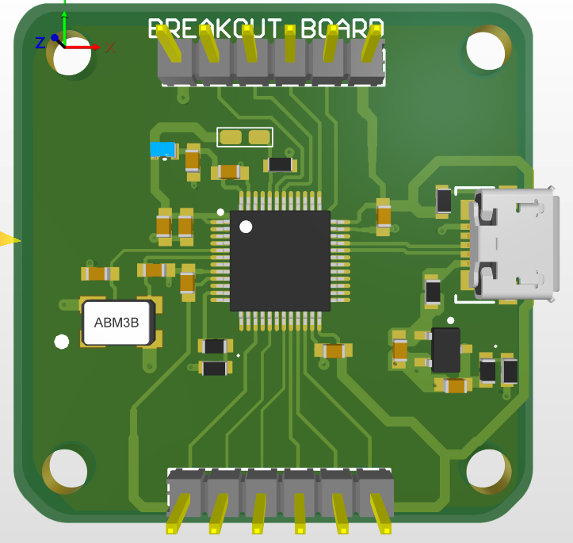
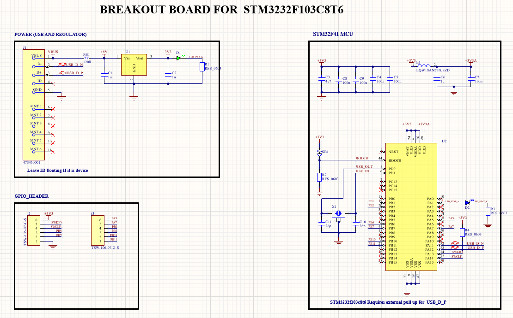
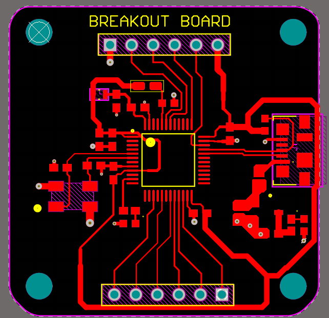

# STM32F103 Breakout Board

A compact 2-layer breakout board for the **STM32F103C8T6** microcontroller, designed in **Altium Designer**. It is powered from 5 V over USB, regulated to 3.3 V on board, and exposes the SWD programming pins and a set of GPIO pins on standard 1x6 headers.



## Features

- **MCU:** STM32F103C8T6 (ARM Cortex-M3)
- **Power:** 5 V input through a USB connector, with an LDO regulator providing 3.3 V
- **Clock:** 8 MHz external crystal (HSE)
- **Programming:** SWD pins broken out on a dedicated 1x6 header
- **GPIO:** a second 1x6 header exposes GPIO pins for your own projects
- **BOOT0 solder jumper:** a custom solder-jumper footprint selects the boot mode, so no extra switch is needed
- **Board:** 2 layers, 35 x 35 mm

## Images

| Schematic | PCB layout |
|-----------|------------|
|  |  |

## Repository structure

```
STM32F103_breakout_board/
├── Altium/           Altium Designer project (schematic, PCB, libraries)
├── Manufacturing/    Gerber, drill, BOM, pick and place, assembly drawing
├── Images/           Schematic, PCB layout and 3D view images
├── other/            Additional files
└── README.md
```

## Opening the design

1. Install **Altium Designer** (the project was made with version 26.4.1).
2. Open `Altium/STM32F103_breakout_board.PrjPcb`.
3. Keep the `Libraries` folder next to the project so the custom footprints (including the BOOT0 solder jumper) load correctly.

## Ordering the board

1. Zip the contents of `Manufacturing/Gerber` together with the drill files from `Manufacturing/Drill`.
2. Upload the zip to a PCB manufacturer such as JLCPCB or PCBWay.
3. Choose **2 layers**, board size **35 x 35 mm**, and your preferred finish and thickness (1.6 mm is standard).
4. For assembly, use the BOM and pick-and-place files in `Manufacturing/BOM`.

## Using the board

**Power:** connect a 5 V source to the USB connector. The LDO provides 3.3 V to the microcontroller.

**Programming:** connect an SWD programmer (such as an ST-Link) to the SWD header.

**Boot mode:** the BOOT0 pin is set with the solder jumper. Leave it in the default position to boot from flash. Bridge the jumper with solder to the other option to enter the bootloader. Do not leave BOOT0 floating.

## Author

Designed by **Bangura**.

## License

Released under the **CERN Open Hardware Licence Version 2 - Permissive (CERN-OHL-P-2.0)**. You are free to use, modify, and share this design, provided you keep the license notice. See the `LICENSE` file for the full text.
